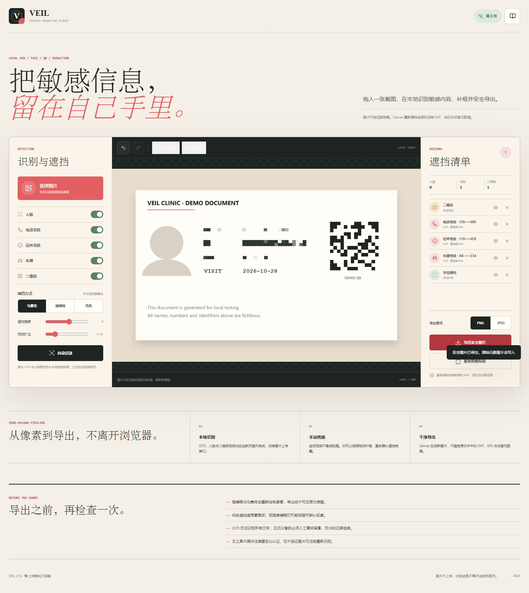

# VEIL · 零上传隐私打码器

**在浏览器本地识别人脸、电话号码、证件号码、车牌和二维码，确认后导出一张干净的新图片。**

VEIL 是一个纯静态 Web 应用。图片不经过服务器，没有账号、上传接口、云端推理或分析埋点。OCR、人脸模型与二维码扫描器全部随站点提供，并可通过 Service Worker 离线使用。



## 功能

- **零上传流水线**：图片只存在于当前标签页内存，刷新即清除。
- **中英文 OCR**：Tesseract.js + `eng` / `chi_sim` 本地语言数据。
- **人脸检测**：TensorFlow.js + BlazeFace；浏览器原生 `FaceDetector` 可选兜底。
- **二维码识别**：jsQR 在本地 Canvas 像素上运行。
- **规则匹配**：识别中国大陆手机号、15/18 位身份证样式与常见车牌样式。
- **手动补框**：直接在图片上拖动创建额外遮挡区域。
- **三种遮挡**：高像素化马赛克、强模糊、纯色覆盖；可调节强度与扩边。
- **完整编辑体验**：区域启停、删除、撤销、重做、按住查看原图。
- **安全导出**：新 Canvas 重新编码 PNG/JPEG，不复制原始 EXIF、GPS 或设备元数据。
- **响应式 PWA**：桌面与移动端可用，安装后支持离线访问。
- **可直接部署**：GitHub Pages、Netlify、Vercel、Docker 与任意静态服务器。

> 自动识别用于减少手工工作，不是匿名化保证。分享前必须人工检查背景、反光、小字和模型漏检。

## 快速开始

需要 Node.js 18 或更高版本。

```bash
pnpm install
pnpm start
```

打开 `http://127.0.0.1:4200`。

```bash
pnpm test
pnpm check
```

项目没有构建步骤。`index.html`、`assets/`、`src/` 与模型文件就是完整运行产物。

## 部署

### GitHub Pages

1. 将仓库默认分支设为 `main`。
2. 在 **Settings → Pages → Source** 选择 **GitHub Actions**。
3. 推送到 `main` 后，[`pages.yml`](.github/workflows/pages.yml) 会先运行测试，再发布静态站点。

### Netlify

导入仓库即可。`netlify.toml` 已设置发布目录、安全响应头与 CSP。

### Vercel

导入仓库，无需 Build Command；`vercel.json` 已提供静态输出与安全响应头。

### Docker

```bash
docker build -t veil-redactor .
docker run --rm -p 8080:8080 veil-redactor
```

打开 `http://127.0.0.1:8080`。

## 隐私设计

1. **同源资源**：脚本、OCR 数据、BlazeFace 模型和二维码解码器都存放在仓库中。
2. **严格 CSP**：`connect-src 'self'` 限制页面连接外部源，`form-action 'none'` 禁止表单外发。
3. **无后端**：仓库不包含上传 API、图片数据库或远程推理调用。
4. **内存处理**：图片通过 `File` / `ImageBitmap` / Canvas 在当前标签页中处理。
5. **干净导出**：导出器创建新 Canvas，不复制原文件元数据区块。
6. **最小存储**：`localStorage` 只记录遮挡样式、强度、格式等显示偏好。

隐私承诺与实际边界详见 [MODEL.md](MODEL.md) 和页面内的[技术与隐私说明](guide.html)。

## 识别范围

| 目标 | 实现 | 主要限制 |
| --- | --- | --- |
| 人脸 | BlazeFace | 侧脸、遮挡、过小或低分辨率人脸可能漏检 |
| 手机号 | OCR + 正则 | 手写、旋转、艺术字体可能漏检 |
| 证件号 | OCR + 15/18 位规则 | 不做真实证件有效性认证 |
| 车牌 | OCR + 中英文规则 | 特殊号牌、污损与异形排版可能漏检 |
| 二维码 | jsQR | 严重反光、破损或极小二维码可能漏检 |
| 其他敏感信息 | 手动补框 | 需要用户自行检查边缘与背景 |

## 工作方式

```text
本地文件
  → ImageBitmap / Canvas
  → 同源加载的 OCR、人脸与二维码模型
  → 候选区域 + 人工补框
  → 新 Canvas 重绘
  → PNG / JPEG Blob
  → 本地下载或剪贴板
```

OCR 与二维码扫描最多处理 1800 px 的长边以控制内存；人脸检测在大图上按模型能力执行。超大原图会先缩放到 4096 px 长边，编辑与导出均采用该安全分辨率。

## 项目结构

```text
.
├── index.html
├── guide.html
├── assets/
│   ├── app.js
│   ├── styles.css
│   ├── models/           # 本地 BlazeFace 模型
│   └── vendor/           # TensorFlow.js、Tesseract、jsQR、Lucide
├── src/redaction.js      # 可测试的检测规则与几何工具
├── tests/                # Node.js 单元测试
├── scripts/serve.mjs     # 安全的本地静态服务器
├── sw.js                 # PWA 离线缓存
└── docs/                 # GitHub README 截图
```

## 浏览器支持

推荐最新版 Chrome、Edge、Firefox 或 Safari。WebAssembly、Canvas 与 Web Worker 是核心能力；图片剪贴板写入取决于浏览器权限。`FaceDetector` 不是必需项，主路径使用随站点提供的 BlazeFace 模型。

## 贡献

请先阅读 [CONTRIBUTING.md](CONTRIBUTING.md)。提交识别相关改动时，只使用合成、公开授权或已彻底去标识化的测试图片，不要提交真实用户敏感图片。

## 许可

应用代码以 [MIT License](LICENSE) 发布。第三方库、模型与 OCR 数据遵循各自许可证，详见 [THIRD_PARTY_NOTICES.md](THIRD_PARTY_NOTICES.md)。
